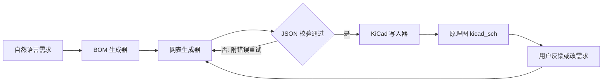

# Agent 架构设计（v0.1 草稿）

> 课程大作业：AI Agent 电路板设计
> 目标：**一句话自然语言 → BOM 元器件清单 → 引脚级网表 JSON → KiCad 8 可打开的原理图**，并支持交互式修正（如"把电容换成 100nF"后重新生成）。

---

## 1. 总体流程



对应作业五步走：**①环境搭建 → ②自然语言→BOM → ③连接关系→网表 JSON → ④导入 KiCad 生成原理图 → ⑤交互修正**。其中③的"校验-重试"环节就是技术路线里说的反馈闭环。

---

## 2. 模块划分

| 模块 | 职责 | 输入 | 输出 |
|---|---|---|---|
| `config` | 读取 config.toml（密钥、路径） | 配置文件 | 配置对象 |
| `llm_client` | 封装 LLM 调用（OpenAI 兼容） | prompt 文本 | 模型响应文本 |
| `bom_generator` | 自然语言 → BOM | 需求句 | `bom.json` |
| `netlist_generator` | BOM + 需求 → 引脚级网表 | bom.json、需求句 | `netlist.json` |
| `validator` | JSON Schema 校验 + 电气 sanity check + 重试 | 模型输出 | 校验结果/错误 |
| `kicad_writer` | netlist.json → `.kicad_sch` | netlist.json | KiCad 8 原理图 |
| `agent` | 编排全流程 + 交互会话状态 | 用户输入 | 各阶段产物 |

---

## 3. 目录规划（对应仓库骨架）

```
ai_agent_pcb/
├── config/
│   ├── config.example.toml   # 模板（提交）
│   └── config.toml           # 真实密钥（被 .gitignore 忽略，不提交）
├── src/
│   ├── config.py             # 配置加载
│   ├── llm_client.py         # LLM 封装
│   ├── bom_generator.py      # 步骤②
│   ├── netlist_generator.py  # 步骤③
│   ├── validator.py          # JSON 校验 + 重试闭环
│   ├── kicad_writer.py       # 步骤④
│   └── agent.py              # 编排 + 交互入口（步骤⑤）
├── examples/                 # BOM / 网表 / 原理图样例与历史版本
├── docs/                     # 本文档、设计报告
├── tests/                    # 各模块单测
└── assets/                   # KiCad 符号库等素材
```

---

## 4. 关键数据结构

### 4.1 BOM（bom.json）

```json
{
  "project": "Arduino 最小系统板",
  "items": [
    { "ref": "U1", "name": "ATmega328P-PU", "qty": 1, "footprint": "DIP-28", "desc": "8 位 MCU" },
    { "ref": "Y1", "name": "晶振 16MHz",    "qty": 1 },
    { "ref": "C1", "name": "瓷片电容 22pF", "qty": 2 },
    { "ref": "R1", "name": "电阻 10kΩ",     "qty": 1, "desc": "复位上拉" },
    { "ref": "R2", "name": "电阻 330Ω",     "qty": 1, "desc": "LED 限流" },
    { "ref": "D1", "name": "LED",           "qty": 1, "desc": "电源指示" },
    { "ref": "C3", "name": "电容 100nF",    "qty": 1, "desc": "去耦" }
  ]
}
```

### 4.2 网表（netlist.json）

```json
{
  "nets": [
    { "name": "VCC",   "pins": ["U1:7",  "U1:20", "R1:2", "R2:1"] },
    { "name": "GND",   "pins": ["U1:8",  "U1:22", "C3:2"] },
    { "name": "XTAL1", "pins": ["U1:9",  "Y1:1"] },
    { "name": "XTAL2", "pins": ["U1:10", "Y1:2"] },
    { "name": "RESET", "pins": ["U1:1",  "R1:1"] }
  ]
}
```

**约束（validator 检查点）：**
- JSON 可解析、字段齐全（`nets[].name`、`nets[].pins`）
- 每个 `器件:引脚` 里的引脚号必须真实存在于对应器件
- 同一引脚不得出现在两个网络（悬空/冲突检查）
- 电源网络命名统一 `VCC`/`GND`

---

## 5. Prompt 设计思路

1. **角色 + 任务**：明确"你是电路设计助手，任务是把 BOM 变成引脚级连接"。
2. **硬约束输出格式**：只输出 JSON，附 schema，禁止解释性文字。
3. **few-shot 示例**：给 1 个正确样例，显著提升格式稳定性。
4. **生成后校验**：JSON 可解析 → Schema 校验 → 引脚存在性检查。
5. **失败自纠**：把具体错误信息附回 prompt 让模型重写（最多 `max_retries` 次）。

网表生成 prompt 骨架：

```
你是电路设计助手。已知元器件清单：{bom}
请给出引脚级连接关系，只输出 JSON，格式：
{"nets":[{"name":"网络名","pins":["器件:引脚"]}]}
要求：电源网络命名 VCC/GND；每个引脚号必须真实存在于对应器件；不要输出 JSON 以外的任何内容。
```

---

## 6. 交互修正设计（步骤⑤）

- `agent` 维护会话状态：当前需求句、BOM、网表、历史版本。
- 用户说"把电容换成 100nF" → 解析变更意图 → 更新 BOM → **只重跑** 网表生成与原理图写入，不必从头再来。
- 每次生成结果按时间戳留档到 `examples/output/`，为设计报告的"实验结果与失败案例分析"攒素材。

---

## 7. 与 8 周里程碑对齐

| 阶段 | 内容 | 里程碑 |
|---|---|---|
| W3–W4 | config + llm_client + bom_generator + netlist_generator + validator 打通 | MVP 演示 |
| W5–W6 | kicad_writer 把 netlist.json → `.kicad_sch`；交互修正 | 原理图生成 |
| W7 | 打磨 prompt；进阶：DRC 检查闭环 | 闭环通过 |

**kicad_writer 的两条实现路线（W5 再定）：**
- 路线 A：KiCad 8 自带 Python（脚本接口）驱动生成 —— 作业推荐口径；
- 路线 B：直接按 KiCad 8 的 S-expression 格式写出 `.kicad_sch` —— 不依赖 KiCad 运行，更可控。
两者产物相同，都要求 KiCad 8 能打开验证。

---

## 8. 失败案例分析框架（写报告用）

每次失败记录：输入需求 / prompt 版本 / 模型原始输出 / 错误类型（JSON 解析失败、引脚不存在、电气错误、格式漂移）/ 修复方式与结果。

---

## 9. KiCad 8 原理图生成关键技术点（已实现并验证）

步骤④把 `netlist.json` 写成 KiCad 8 的 `.kicad_sch`（S-expression 格式，版本 `20231120`）时，踩过以下坑，均已解决：

1. **引脚藏在嵌套子符号里**：KiCad 8 的符号引脚并不直接挂在顶层 `(symbol ...)` 下，而是在子单元符号（如 `C_0_1`/`C_1_1`）内部。解析时必须递归收集所有 `pin` 节点，否则会解析出 0 个引脚，导致后续连线全部被跳过。
2. **引脚号是带引号字符串**：`(number "1")` 里的 `"1"` 是字符串而非整数，需 `int(num[1].strip('"'))` 提取，否则 `int("1")` 抛错被吞掉、退化为 0 引脚。
3. **原理图必须内嵌 `(lib_symbols ...)`**：只写 `(lib_id "Device:C")` 而把符号定义留给全局库时，`kicad-cli sch erc` 会因解析不到符号而崩溃/报错。本项目在生成时把用到的符号定义完整内嵌进文件，使其自包含、可被 CLI 独立校验。
4. **KiCad 原理图解析器无法解析 `extends` 继承链**：直接把 `ATmega328P-P`（它 `extends` 基类）原样内嵌会导致"加载失败"。解决办法是**扁平化**——以最底层祖先的完整定义为基础、重命名为目标符号名、去掉 `extends`、并应用派生层的属性覆盖，得到单一、自包含、无继承的符号定义。
5. **实例 `lib_id` 用裸名**：若保留库前缀（如 `MCU_Microchip_ATmega:ATmega328P-P`），`kicad-cli` 的 ERC 会去查全局符号库（该符号有更深的 `extends` 链），在无项目/符号库表的环境下直接段错误；改成裸名 `ATmega328P-P` 后，KiCad 只从内嵌 `lib_symbols` 解析，ERC 正常运行。

**验证结果**：`python -m src.cli "帮我设计一块 Arduino 最小系统板" --mock` 可生成 `bom.json` + `netlist.json` + `Arduino_最小系统板__ATmega328P_PU_.kicad_sch`；对生成的原理图执行 `kicad-cli sch erc` 退出码 0 并产出完整 ERC 报告（最小系统板只接了必要网络，其余 GPIO 故意留空，因此报告中会有若干"引脚未连接"类提示，属预期）。

---

## 10. AI 使用声明

本架构文档由 AI 辅助起草，作者已审阅并将持续修改。（按课程要求，最终报告中会完整申报哪些内容由 AI 生成、使用了什么模型。）
